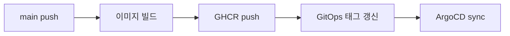

# PR 작성 컨벤션

이 문서는 Team-Neki-Server PR의 제목과 본문을 쓰는 기준을 다룹니다. 사람이 직접 쓸 때와 에이전트(Claude Code 등)에게 맡길 때 같은 기준을 씁니다. 에이전트에게 맡길 때는 마지막 절의 [PR 작성 프롬프트](#pr-작성-프롬프트)를 그대로 넘기면 됩니다.

## 제목

- 형식 : `{type}/BACKEND-{번호} 설명`
- type : 브랜치 prefix와 같음 (`feat`, `fix`, `refactor`, `chore`, `docs`, `test`)
- 설명 : 머지 후 달라지는 동작을 한 줄로. 작업 과정("~ 작업", "~ 수정 1차")은 쓰지 않음

```text
fix/BACKEND-265 사진 memo 길이를 255자로 검증해 400 을 반환한다
chore/BACKEND-271 API 배포 워크플로에 concurrency 추가
```

## 본문은 어떻게 구성하는가?

본문은 **배경 -> 변경 내용 -> 검증** 세 절로 씁니다. 틀은 `.github/PULL_REQUEST_TEMPLATE.md`에 있습니다. 리뷰어가 "왜 바꾸는가"를 먼저 이해해야 diff를 맥락 안에서 읽을 수 있기 때문에 배경을 맨 앞에 둡니다.

### 배경

- 무엇이 문제였고 왜 지금 고치는지를 2~4문장 산문으로 씀
- 문제의 영향(사용자 증상, 장애, 비용, 리뷰 지적 등)을 한 문장 이상 포함
- Sprint 티켓 링크 한 줄 : `[BACKEND-123](https://sprint.suitestudy.com:4641/tasks/{티켓 id})`
- 티켓 설명을 복사하지 않음. 리뷰어가 티켓을 열지 않아도 이해되는 수준으로 요약

### 변경 내용

- 핵심 변경 3~5개를 불릿으로 씀. 파일·클래스 목록이 아니라 동작이 어떻게 달라지는지를 씀
- 리뷰어가 판단해야 할 설계 선택이 있으면 고른 쪽과 버린 대안을 한 줄로 병기
- 흐름이 바뀌면 mermaid 다이어그램을 넣음 (아래 기준 참고)

### 검증

- 실행한 명령과 결과 (e.g. `./gradlew :apps:api:test` N건 통과, 실패 0)
- 실행하지 않은 검증과 실측하지 않은 수치는 쓰지 않음
- 확인하지 못한 것과 배포 후 확인할 것을 숨기지 않고 적음
- 머지 전에 리뷰어나 다른 팀의 결정이 필요하면 `**머지 전 확인:**`으로 시작하는 한 줄을 마지막에 둠

## 얼마나 자세히 쓰는가?

PR 본문은 작업 일지가 아니라 리뷰 안내문입니다. diff를 읽으면 바로 보이는 내용은 본문에서 빼는 것이 좋습니다.

- 목표 길이 : 다이어그램을 빼고 한 화면(약 40줄) 이내
- 쓰지 않는 것
  - 커밋 순서대로 나열한 작업 과정
  - 변경 파일 전체 목록
  - 포맷팅, import 정리, 이름 변경 같은 부수 변경
  - 시도했다가 되돌린 내용 (결론에 영향을 줬다면 대안으로 한 줄만)

## mermaid는 언제 넣는가?

이 저장소의 PR은 요청 처리, 배치 잡, CI/배포 workflow처럼 순서가 있는 변경이 많습니다. 흐름이 바뀌는 PR은 산문보다 다이어그램 하나가 빠르게 읽힙니다.

- 넣는 경우 : 요청 처리 순서, 배치 step, CI/배포 workflow, 상태 전이, 시스템 간 호출이 바뀔 때
- 넣지 않는 경우 : 흐름 변화 없이 한 지점만 고칠 때 (검증 로직 추가, 설정값 변경, 문서 수정 등)
- 바뀐 구간만 그림. 노드는 10개 이내
- 순서가 중요하면 `sequenceDiagram`, 분기·단계가 중요하면 `flowchart`
- ASCII 그림은 쓰지 않음 (GitHub이 mermaid를 렌더링함)

배포 workflow를 바꾼 PR이라면 다음 정도면 충분합니다.



## 문체

- 산문 : "~습니다"체
- 불릿 : 개조식 (명사형 종결, ~함/~음)
- 클래스명, 설정 키, 명령어는 백틱으로 감쌈
- 이모지는 쓰지 않음 (도구가 본문 끝에 붙이는 attribution 줄은 예외)

## PR 작성 프롬프트

에이전트에게 PR 제목과 본문을 맡길 때 아래 블록을 그대로 프롬프트로 씁니다. `{base}`는 PR의 base 브랜치입니다.

```text
현재 브랜치의 PR 제목과 본문을 작성한다.

기준: docs/conventions/pull-request.md 의 제목, 본문 구성, 상세도, mermaid, 문체 절을 모두 따른다.

입력
- git log --oneline origin/{base}..HEAD
- git diff origin/{base}...HEAD
- 브랜치 이름의 Sprint 티켓 (BACKEND-번호). 대화 맥락에 없으면 sprint MCP get_ticket 으로 조회한다.

출력
- 제목 한 줄, 그리고 .github/PULL_REQUEST_TEMPLATE.md 의 세 절을 채운 본문. 템플릿 주석은 지운다.
```
