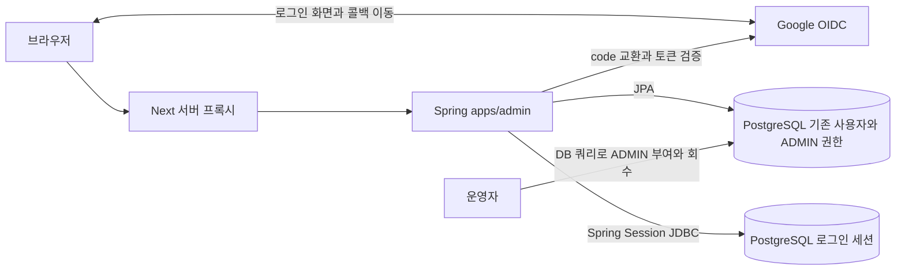
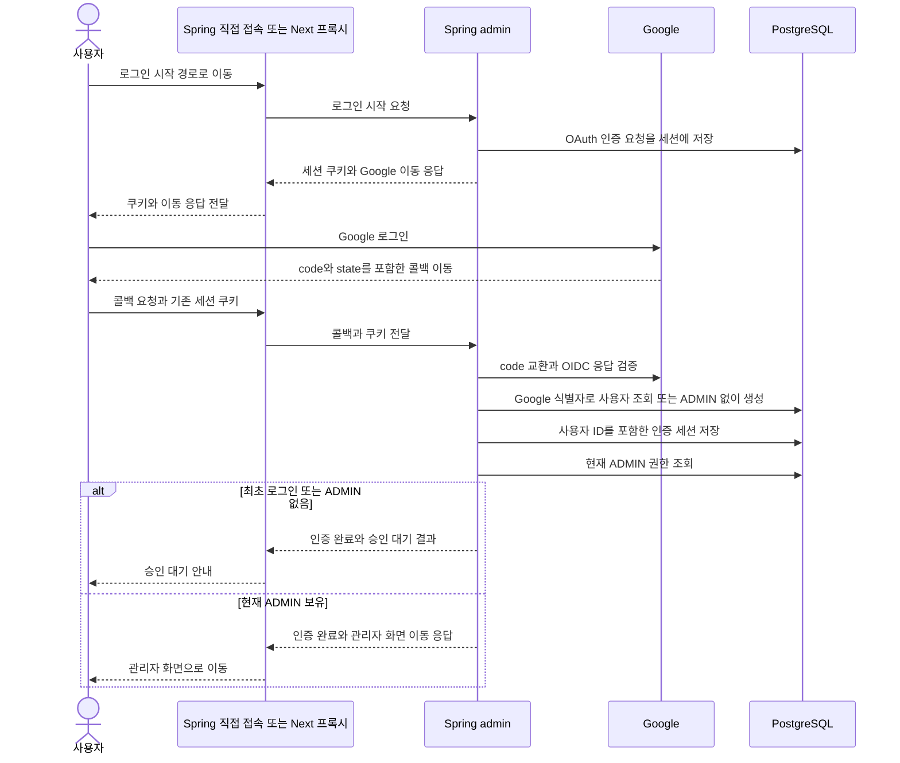

# 어드민 인증과 인가 HLD

어드민은 Google 계정으로 신원을 확인하고, 운영자가 DB에서 승인한 사용자에게만 `ADMIN` 권한을 부여합니다. OAuth 처리와 세션 관리는 Spring이 담당하며 세션은 PostgreSQL에 저장합니다. 초기에는 Spring 콜백으로 개발하고 이후 Next 서버가 로그인 시작·콜백·관리 API 요청을 프록시합니다.

## 0 핵심 설계와 결정 상태

### 합의한 요구사항

| 항목 | 요구사항 |
|---|---|
| 로그인 | Google OAuth 로그인 사용. 신원 확인은 OIDC Authorization Code 흐름으로 구성 |
| 인가 | Spring이 `ADMIN` 권한을 검사. 화면 숨김이나 Next 검사만으로 접근을 허용하지 않음 |
| 계정 모델 | 기존 `User`와 `RoleType.ADMIN` 재사용. 초기에는 별도 관리자 계정·승인 테이블을 추가하지 않음 |
| 로그인 유지 | Spring Session JDBC로 세션 로그인 구현. 저장소는 PostgreSQL |
| 세션 만료 | 마지막 세션 접근 후 30분 동안 요청이 없으면 만료 |
| 책임 | OAuth 응답 검증·Google code 교환·세션 발급과 무효화는 Spring 담당 |
| Next | OAuth 클라이언트나 별도 세션 발급자가 되는 대신 서버 프록시 담당 |
| 개발 순서 | 먼저 Spring 엔드포인트를 Google redirect URI로 사용하고 이후 Next 경유로 전환 |
| 최초 승인 | Google 로그인 후 ADMIN이 없으면 승인 대기 안내. 운영자가 DB 쿼리로 `ROLE_ADMIN` 부여 |
| 권한 부여 반영 | 유효한 Google 로그인 세션이 있으면 재로그인 없이 다음 관리 요청부터 ADMIN 권한 적용 |
| 권한 회수 반영 | 관리 요청마다 DB의 현재 사용자 권한을 확인하고 ADMIN 회수 후 다음 요청부터 차단 |
| 승인 절차 개선 | 승인 UI·자동화·별도 승인 이력 모델은 후속 개선으로 진행 |
| 요청 보호 | 세션 쿠키와 함께 CSRF 보호 적용 |

### 초안에서 제안하는 선택

| 항목 | 기본안 | 결정 상태 |
|---|---|---|
| CSRF 토큰 전달 | `/auth/me`의 `X-CSRF-TOKEN` 응답 헤더로 전달하고 클라이언트 메모리에 보관 | 구현 |
| 세션 쿠키 | 어드민 전용 쿠키와 운영 보안 속성 적용 | 이름은 구현 시 지정 |
| Next 연결 계약 | 로그인 시작과 콜백을 함께 프록시하고 쿠키·리다이렉트를 중계 | 외부 경로·헤더 처리 합의 필요 |

세션은 Spring Session JDBC로 관리하고 사용자·권한은 기존 JPA 모델로 저장합니다. 초기 승인 여부의 기준은 기존 사용자 권한에 `ROLE_ADMIN`이 있는지이며, 별도 승인 상태를 중복 저장하지 않습니다.

기존 [이메일·비밀번호 및 JWT 설계](../superpowers/specs/2026-08-16-admin-auth-design.md)와 [구현 계획](../superpowers/plans/2026-08-16-admin-auth.md)은 이번 요구사항과 다릅니다. 새 인증 구현은 이 HLD 검토 후 별도 LLD로 구체화합니다.

## 1 배경과 범위

현재 `apps/admin`은 Brand와 Pose 관리 API를 제공하지만 Spring Security 자동설정을 제외하고 있습니다. Google 인증과 관리자 승인을 추가해 실제 운영 데이터에 접근할 수 있는 사용자를 제한해야 합니다.

초기 관리자는 운영자가 직접 식별하고 승인할 수 있는 규모를 전제로 합니다. DB 쿼리로 기존 사용자에게 ADMIN을 부여하며, 별도 승인 절차와 이력 모델은 후속 개선으로 둡니다. Discord 승인 버튼·승인자 검증·관리자 승인 UI는 초기 범위에 포함하지 않습니다. 단순 Discord 신청 알림은 선택 사항이며 로그인·권한 부여 성공의 조건으로 사용하지 않습니다.

이번 범위는 로그인, 승인 대기, 관리자 인가, 세션 유지·만료·로그아웃, PostgreSQL 연결과 Next 전환 계약입니다. 모바일 API의 JWT 로그인, 비밀번호 로그인, 자체 JWT 발급, 세부 권한별 RBAC, Google API의 오프라인 접근은 포함하지 않습니다.

## 2 인증 추가 전 구조와 제약

초기 PR #315의 인증 없는 앱 구조를 출발점으로 설계했습니다. 이후 실행 모듈 PR #356에서 PostgreSQL·기존 Jasypt 연결과 Flyway validate 전용 구성이 추가됐으며, 인증 구현은 이 최신 구성을 유지합니다.

- `AdminApplication`이 Spring Security 관련 자동설정 세 가지를 제외합니다. 인증 구현 시 admin 전용 `SecurityFilterChain`을 구성해야 합니다.
- 초기 메모리 H2 구성은 실행 모듈 PR #356에서 PostgreSQL 공통 설정으로 전환됐습니다. 운영 DB는 API와 같은 설정과 기존 Jasypt Secret을 사용하며, H2는 테스트에만 사용합니다.
- `User`에는 외부 계정 식별자인 `oid`, `providerType`, 권한 문자열 `roles`가 있으며 `RoleType.ADMIN`의 실제 authority는 `ROLE_ADMIN`입니다. `ProviderType`에는 아직 Google이 없습니다.
- admin은 필요한 도메인 서비스만 명시적으로 등록합니다. 인증 추가를 이유로 전체 도메인이나 모바일 API 보안 설정을 스캔하지 않습니다.
- 현재 Next의 `admin-api-proxy.ts`는 API 조회를 중계하지만 `Cookie`, `Set-Cookie`, OAuth 리다이렉트 처리는 하지 않습니다.

## 3 전체 구조와 책임

초기 개발에서는 브라우저가 Spring에 직접 접속합니다. 이후 Next가 경로를 중계해도 Google과 통신하는 OAuth 클라이언트와 세션의 소유자는 Spring으로 유지합니다. Next에 별도 Google client secret이나 로그인 세션 저장소를 만들지 않습니다.

| 구성요소 | 책임 |
|---|---|
| 브라우저 | 로그인 화면 이동, 세션 쿠키 전송, CSRF 토큰을 포함한 변경 요청 |
| Next 서버 | 허용된 admin 경로 중계, 요청 쿠키·CSRF 헤더 전달, 응답 쿠키·CSRF 헤더·리다이렉트 전달 |
| Spring Security | OAuth 요청 상관관계와 OIDC 응답 검증, 인증 상태 저장, 세션·CSRF·접근 제어 |
| admin 애플리케이션 | 사용자와 Google 신원 연결, ADMIN 보유 여부 조회, 관리자 로그인 결과 결정 |
| 도메인과 JPA | 기존 사용자·권한 저장 및 도메인 규칙 |
| PostgreSQL 세션 저장소 | OAuth 진행 중 상태와 로그인 세션의 저장·조회·만료 |
| 운영자 | 사용자 신원 확인 후 DB 쿼리로 ADMIN 부여 또는 회수 |

## 4 로그인과 승인 흐름

### 최초 로그인

Google `sub`를 기준으로 계정을 찾습니다. Google만 지원하는 초기안에서는 `(GOOGLE, sub)`를 외부 계정 키로 사용하고, 이메일은 표시·수동 신원 확인용으로 둡니다. 이메일이 같다는 이유로 기존 카카오·애플 계정과 자동 연결하지 않습니다. ID 토큰의 서명·issuer·audience·만료와 로그인 요청의 state·nonce 검증은 Spring Security의 OIDC 흐름에 맡깁니다. [Google OIDC 기준](https://developers.google.com/identity/openid-connect/openid-connect), [Spring OAuth2 Login](https://docs.spring.io/spring-security/reference/6.5/servlet/oauth2/login/advanced.html)

최초 로그인은 기존 `User` 모델로 사용자를 생성하며 `ROLE_ADMIN`을 자동 부여하지 않습니다. 동일 Google 계정의 반복·동시 로그인은 기존 사용자를 재사용합니다. 로그인 시 운영자가 부여하거나 회수한 권한을 덮어쓰지 않습니다.

대기 사용자는 Google로 인증된 사용자이지만 현재 관리 권한은 없습니다. ADMIN 보유 여부와 관계없이 Google 인증을 마치면 내부 사용자 ID에 연결된 로그인 세션을 유지합니다. 세션은 신원 확인에 사용하고, 관리 권한은 요청 시 DB에서 판단합니다. ADMIN이 없는 동안에는 본인 상태 조회와 로그아웃만 허용합니다. `PENDING`은 승인 대기를 나타내는 응답·화면 상태이며, 별도 역할이나 DB 승인 상태로 저장하지 않습니다.

### DB 수동 승인

1. 운영자가 내부 사용자 ID, Google 계정 정보와 현재 권한을 확인합니다.
2. DB 트랜잭션에서 대상 사용자에게 쿼리로 `ROLE_ADMIN`을 부여합니다. 기존 다른 권한은 보존하고 ADMIN을 중복 추가하지 않습니다.
3. 대상과 변경 행 수를 확인한 뒤 커밋하고, 처리자·시각·권한 변경 내역을 운영 기록에 남깁니다.
4. 권한 부여 커밋 이후 사용자의 다음 관리 요청에서 Spring이 현재 ADMIN 권한을 조회하고 접근을 허용합니다. 사용자는 재로그인할 필요가 없습니다.

승인은 최초 권한 부여 시 수행하며 매 로그인마다 반복하지 않습니다. 기존 로그인 세션의 권한 값을 승격하거나 세션을 다시 발급하지 않고 DB의 현재 권한으로 인가합니다. 대기 화면에서는 상태 새로고침이나 권한 확인으로 `/auth/me`를 다시 호출해 관리자 화면으로 이동할 수 있습니다. 세션이 이미 만료됐거나 로그아웃한 경우에만 다시 로그인합니다. 실제 권한 부여·회수 SQL과 확인 절차는 기존 권한 저장 형식에 맞춰 runbook에 둡니다. 별도 승인 API·상태 전이·이력 테이블은 이후 승인 절차를 추가할 때 설계합니다.

### 관리 요청과 권한 회수

관리 API는 다음 조건을 모두 요구합니다.

- 유효한 Google 로그인 세션으로 내부 사용자 ID가 확인된 상태
- DB의 현재 사용자 권한에 정확한 authority `ROLE_ADMIN`이 존재
- 사용자가 존재하며 탈퇴·사용 불가 상태가 아님

관리 요청마다 DB의 현재 사용자 권한을 조회하며 역할 캐시나 세션에 저장된 과거 authority를 인가 기준으로 사용하지 않습니다. Spring Security의 `AuthorizationManager` 등 요청 인가 경계에서 기존 ADMIN 권한을 검사합니다. 세션 생성 시점의 `hasRole` 검사만으로 접근을 결정하지 않습니다. [Spring 요청 인가](https://docs.spring.io/spring-security/reference/6.5/servlet/authorization/authorize-http-requests.html)

권한 부여·회수가 커밋된 뒤 인가 조회를 시작한 요청부터 변경이 적용됩니다. 이미 인가를 통과해 실행 중인 요청은 별도 중단 대상이 아닙니다. `/auth/me`도 같은 기준으로 현재 권한을 조회해 화면 표시와 서버 인가의 기준을 맞춥니다.

회수는 DB 쿼리로 기존 사용자 권한에서 `ROLE_ADMIN`만 제거합니다. 세션 삭제가 지연되더라도 다음 관리 요청은 거부합니다. 초기 모델은 최초 미승인과 권한 회수를 별도 상태로 구분하지 않으며, 관리 권한 재부여는 운영자의 명시적 처리로만 허용합니다.

## 5 기존 계정과 권한 모델

계정과 관리자 권한은 기존 `User`, `RoleType.ADMIN`, `TB_USERS`의 권한 저장 형식으로 관리합니다.

| 데이터 | 개념 모델 | 저장 방식 |
|---|---|---|
| 사용자 | 기존 `TB_USERS`. 내부 ID, `providerType=GOOGLE`, `oid=sub`, 이메일, 권한 | 기존 JPA |
| 세션 | admin 전용 세션 및 속성 테이블 | Spring Session JDBC |

승인 여부는 기존 `roles`에 `ROLE_ADMIN`이 있는지로 판단합니다. 승인 상태와 권한을 이중으로 관리하지 않습니다. 최초 Google 로그인만으로 ADMIN이 부여되지 않으며, 기존 ADMIN을 보유한 Google 사용자는 별도 승인 행 없이 로그인할 수 있습니다.

Google 식별자 중복은 DB 제약으로 막습니다. 기존 사용자 데이터의 중복 여부를 확인한 뒤 제약 범위를 정합니다. Google 프로필 이름을 현재 길이 제한이 있는 `User.name`에 그대로 복사하지 않고 기존 사용자 필드의 제약에 맞춰 매핑합니다.

모바일 앱의 가입 유스케이스를 그대로 호출해 앱 가입 알림이나 통계를 변경하지 않습니다. `TB_USERS`를 공유하므로 Google 사용자가 전체 사용자 수 집계 등에 미치는 영향과 기존 ADMIN 사용처를 구현 시 확인합니다. 계정 모델은 기존 구조를 유지하고 필요한 집계·이벤트 범위를 조정합니다.

## 6 세션 저장 방식과 선택 이유

| 선택지 | 제공되는 것 | 직접 관리할 것 |
|---|---|---|
| Spring Session JDBC 채택 | PostgreSQL 기반 `HttpSession` 연동, 세션·속성 저장, 만료 세션 정리 | 스키마, 쿠키·만료 정책, 저장 속성의 호환성 |
| JPA 기반 `SessionRepository` 대안 | 기존 JPA 접근 방식과 통일 가능 | Spring Session 저장소 구현, 속성 저장·복원, 만료·정리, 병렬 요청의 변경 충돌 |

사용자·권한 데이터를 JPA로 유지하면서 세션은 Spring Session JDBC에 맡깁니다. 기본 세션 CRUD SQL은 라이브러리가 제공하므로 애플리케이션에서 문자열 쿼리를 직접 작성하지 않습니다. 같은 PostgreSQL과 DataSource를 사용할 수 있습니다. [Spring Session JDBC](https://docs.spring.io/spring-session/reference/3.5/configuration/jdbc.html)

JPA 기반 저장소는 저장 계층을 통일할 수 있지만 기본 제공 구현이 없어 세션 수명과 동시 요청의 변경 보존까지 직접 구현·검증해야 합니다. 이 유지보수 범위를 줄이기 위해 Spring Session JDBC를 선택합니다. [Spring Session 저장소 확장](https://docs.spring.io/spring-session/reference/3.5/api.html#customizing-sessionrepository)

Spring의 인증 상태와 OAuth 진행 중 세션을 같은 JDBC 저장소에 저장합니다. 세션 저장소 장애 시 메모리 세션으로 대체하지 않습니다. 세션에는 내부 사용자 ID 등 필요한 인증 정보만 저장하고 JPA 엔티티 그래프를 직접 보관하지 않습니다.

## 7 엔드포인트와 접근 제어

아래 경로는 Spring 기준 초안입니다. Next의 외부 경로 매핑은 전환 계약에서 확정합니다.

| 메서드와 경로 | 용도 | 접근 조건 |
|---|---|---|
| `GET /oauth2/authorization/google` | Google 로그인 시작 | 익명 허용, 브라우저 이동으로 호출 |
| `GET /login/oauth2/code/google` | Google 콜백 | 별도 로그인은 요구하지 않으며 OAuth 요청 상관관계 검증 필수 |
| `GET /admin/v1/auth/me` | 본인·현재 ADMIN 권한·세션 상태와 CSRF 토큰 조회 | Google 인증 세션의 본인. 대기·권한 회수 상태 포함 |
| `POST /admin/v1/auth/logout` | 세션 무효화와 쿠키 삭제 | 유효한 세션과 CSRF 토큰 |
| 그 외 `/admin/v1/**` | Brand·Pose 등 관리 API | 유효한 Google 로그인 세션과 현재 DB의 ADMIN 권한 |

인증 관련 예외 경로는 관리 API의 포괄 규칙보다 먼저 매칭합니다. 나머지 경로는 기본 거부하며, 관리 API의 미인증 요청은 `401`, 인증됐지만 권한이 없는 요청은 `403`으로 응답합니다. API 호출을 Google 로그인 HTML로 자동 리다이렉트하지 않습니다.

승인·권한 부여용 공개 HTTP API는 초기 범위에 포함하지 않습니다. 수동 DB 변경만으로 최초 ADMIN을 만들 수 있어 별도 기본 비밀번호나 관리자 시드 계정이 필요하지 않습니다.

## 8 쿠키와 CSRF 정책

세션 쿠키는 어드민 전용 이름을 사용합니다. 운영 기본안은 `HttpOnly`, `Secure`, `SameSite=Lax`, `Path=/`이며 `Domain`을 지정하지 않는 host 전용 쿠키입니다. 로컬 HTTP 개발의 `Secure` 예외는 개발 설정에 한정합니다.

세션 유휴 만료는 **30분**으로 설정합니다. 로그인 시점부터 고정 30분이 아니라 마지막 세션 접근 이후 30분 동안 요청이 없을 때 만료하며, 세션을 사용하는 요청이 있으면 유휴 시간이 갱신됩니다. 자동 로그인 유지 기능은 초기 범위에서 제외합니다. Next를 포함한 자동 조회가 세션 만료를 계속 연장할 수 있으므로 불필요한 주기적 상태 조회는 두지 않습니다.

OAuth 시작 시 만들어진 세션이 콜백까지 이어져야 하며, 인증 완료 시 세션 고정 공격 방지 기능을 유지합니다. 로그아웃은 서버 세션을 무효화하고 같은 이름·범위의 쿠키를 삭제합니다. [Spring 세션 관리](https://docs.spring.io/spring-security/reference/6.5/servlet/authentication/session-management.html)

변경 요청과 로그아웃은 CSRF 토큰을 검증합니다. Spring이 세션에 연결된 토큰을 생성·저장하고 `/auth/me`의 `X-CSRF-TOKEN` 응답 헤더로 클라이언트에 전달합니다. 클라이언트는 토큰을 런타임 메모리에 보관하고 POST·PATCH·DELETE 요청과 로그아웃의 같은 이름의 요청 헤더에 넣습니다. Next는 me의 응답 헤더와 브라우저가 보낸 요청 헤더를 그대로 중계하며, 요청마다 토큰을 대신 발급받아 붙이는 방식으로 구현하지 않습니다.

토큰을 영구 저장하거나 매 요청 새로 발급받을 필요는 없습니다. 페이지 새로고침으로 메모리 값이 사라지면 `/auth/me`에서 다시 받습니다. 로그인으로 이전 토큰이 초기화되면 새 토큰을 받고, 로그아웃·세션 만료 시 클라이언트의 보관 값을 버립니다. 로그아웃 이후 다음 로그인은 OAuth 흐름으로 시작하며, 인증 완료 후 `/auth/me`에서 새 토큰을 받습니다. OAuth의 state 검증과 관리 API의 CSRF 검증을 각각 유지합니다. [Spring CSRF](https://docs.spring.io/spring-security/reference/6.5/servlet/exploits/csrf.html)

## 9 Spring 직접 콜백에서 Next 프록시로 전환

### 개발 초기

Google redirect URI는 개발용 Spring 콜백 주소로 등록합니다. 로그인 시작과 콜백을 같은 Spring 세션 경로로 검증하고 승인 대기·수동 권한 부여·매 요청 인가·관리 API를 먼저 완성합니다.

### Next 연결 이후

Google redirect URI를 외부 Next 콜백 주소로 바꾸고, 로그인 시작과 콜백을 동시에 Next 경유로 전환합니다. 콜백만 바꿔 기존 host의 쿠키에 의존하지 않습니다. host가 바뀌는 전환 시 기존 개발 세션 유지는 보장하지 않고 다시 로그인합니다.

| 방향 | 필요한 중계 계약 |
|---|---|
| 브라우저 → Next → Spring | 어드민 세션 쿠키, CSRF 헤더, 허용된 쿼리와 본문 전달 |
| Spring → Next → 브라우저 | 상태 코드, 모든 `Set-Cookie`, `Location`, me의 `X-CSRF-TOKEN` 응답 헤더 보존. 로그인 응답을 Next 서버가 자동으로 따라가지 않음 |
| Google → 외부 콜백 | Google 등록 URI, 인증 시작 요청과 code 교환의 `redirect_uri`를 같은 외부 주소로 유지 |
| 외부 주소 해석 | 환경별 외부 URL을 명시하거나 신뢰된 프록시의 forwarded 헤더만 사용. 임의 입력으로 콜백 주소를 만들지 않음 |

Next는 고정된 Spring admin 대상과 허용 경로만 중계합니다. 브라우저가 지정한 임의 URL로 쿠키를 전달하지 않으며, 인증·상태 조회와 관리 API 응답은 공유 캐시나 정적 결과로 재사용하지 않습니다. Next의 쿠키 설정은 Route Handler 등 서버 응답 경계에서 처리합니다. [Next 쿠키 API](https://nextjs.org/docs/app/api-reference/functions/cookies)

OAuth 브라우저 리다이렉트 자체와 다른 origin의 API 호출에 대한 CORS는 구분합니다. Next 연결의 목표는 브라우저가 어드민의 같은 origin으로 로그인과 API를 호출하도록 만드는 것입니다. 외부 호스트·경로·리다이렉트 목적지·헤더 처리 합의가 이 단계의 선행 조건입니다.

## 10 모듈과 마이그레이션 영향

| 영역 | 변경 범위 |
|---|---|
| `apps/admin` | 전용 보안 체인, OAuth 로그인 연결, 인증 결과·세션·CSRF·접근 제어, PostgreSQL 프로파일 |
| `domain/user` | 기존 User·ADMIN 재사용, Google 계정 식별과 현재 사용자 권한 조회 |
| `modules/postgres` | Google 식별자 중복 방지 제약과 세션 테이블의 Flyway 마이그레이션 |
| Team-Neki-Admin | 로그인·대기·오류 UI, 로그인·콜백·쿠키·CSRF 프록시 |
| Team-Neki-GitOps | 인증 구현 후 PostgreSQL·Google 자격증명·외부 URL 설정. API Service 내부 배치 유지 |
| 기존 모바일 API | JWT 발급·검증 유지. Google admin 로그인을 모바일 로그인 제공자로 자동 확장하지 않음 |

공유 스키마의 변경은 기존 `modules/postgres` Flyway가 소유합니다. 현재 API가 migrate하는 배포 경로를 유지하고 admin은 batch와 같은 Flyway validate 전용 전략으로 스키마를 검증한 뒤 기동합니다. 앱 기동 중 임의 DDL 생성이나 세션 스키마 자동 초기화와 Flyway를 중복 사용하지 않습니다.

Google client secret과 DB 비밀번호는 배포 Secret에서 주입합니다. `User` 재사용으로 추가되는 provider 값과 ADMIN 권한이 기존 API·통계·사용자 이벤트에 주는 영향은 구현 전에 확인합니다. 기존 도메인 전체 스캔이나 모바일 JWT 보안 체인의 재사용은 피하고 [계층 정책](../layering-policy.md)에 따라 필요한 구성만 연결합니다.

## 11 실패 처리와 운영 확인

| 상황 | 처리 |
|---|---|
| Google 거절·state/nonce 불일치·유효하지 않은 토큰 | 관리자 인증 실패. 권한 부여 없이 다시 로그인 안내 |
| 최초 로그인 저장 실패 | 사용자 저장 실패 시 로그인 세션을 확정하지 않고 재시도 안내 |
| 반복·동시 로그인 | 외부 계정 키의 중복 방지. 기존 사용자와 권한 재사용 |
| 세션 만료·없는 쿠키 | 관리 API `401`, 다시 로그인 |
| ADMIN 미보유·권한 회수 | 관리 API `403`, 관리 권한이 없음을 안내 |
| CSRF 누락·불일치 | 변경 요청 `403`, 토큰 재조회 후 사용자 재시도 |
| PostgreSQL 장애 | 관리 요청 `503` 등 서비스 오류. 인증 실패나 승인 대기로 오인시키지 않으며 접근 허용으로 대체하지 않음 |
| 선택적 Discord 알림 실패 | 저장된 사용자·권한 유지. 로그인 흐름과 분리 |

운영 확인에는 로그인 성공·실패, 최초 사용자 생성, 권한 거부, 세션 저장소 오류를 남깁니다. OAuth code, 세션 쿠키, Google 토큰과 client secret은 로그에 남기지 않습니다. DB 쿼리로 권한을 부여·회수할 때는 내부 사용자 ID, 변경 전후 권한, 처리자와 시각을 운영 기록에 남깁니다.

## 12 구현 순서와 완료 조건

1. 기존 User·ADMIN 구조를 확인하고 Google 식별자 제약과 Spring Session JDBC 테이블의 PostgreSQL 마이그레이션을 준비합니다.
2. Spring 직접 콜백으로 Google 로그인과 ADMIN 미보유 사용자의 대기 안내를 구현합니다.
3. DB 쿼리 권한 부여·회수 절차와 매 관리 요청의 현재 ADMIN 인가를 연결합니다.
4. 세션 쿠키·유휴 만료 30분·로그아웃·CSRF 및 서버 재시작 후 세션 복원을 검증합니다.
5. Next 경로·헤더 계약을 확정하고 동일 흐름을 Next 프록시 경유로 검증합니다.
6. 인증과 PostgreSQL 설정에 맞게 배포 구성을 조정한 뒤 실제 운영 배포를 진행합니다.

완료 판단은 다음 사용자 흐름으로 확인합니다.

- 처음 Google 로그인한 사용자는 ADMIN이 없는 대기 상태이며 Brand·Pose 조회와 변경이 모두 차단됩니다.
- 반복 로그인해도 사용자는 중복 생성되지 않으며, 이메일이 같은 다른 제공자 계정과 자동 연결되지 않습니다.
- Google 로그인 세션이 유효하면 DB에서 ADMIN을 부여한 뒤 재로그인 없이 다음 관리 요청부터 접근할 수 있습니다.
- 로그인한 관리자의 권한을 DB에서 회수하면 다음 관리 요청부터 차단됩니다.
- CSRF 없는 변경 요청은 거부되고 유효한 세션·권한·CSRF가 있는 요청만 처리됩니다.
- 페이지 새로고침 후 `/auth/me`에서 CSRF 토큰을 다시 받아 변경 요청과 로그아웃을 수행할 수 있습니다.
- 마지막 세션 접근 후 30분 동안 요청이 없으면 만료되고, 그 전에 세션을 사용하는 요청이 있으면 유휴 시간이 갱신됩니다.
- 로그아웃·만료 세션은 재사용할 수 없고 서버 재시작은 PostgreSQL의 유효 세션을 보존합니다.
- Next 경유 로그인과 일반 API에서 쿠키·콜백·리다이렉트가 이어지고 사용자 간 캐시가 공유되지 않습니다.

기존 PR #315는 닫혔고 실행 모듈 [#356](https://github.com/Team-Neki/Team-Neki-Server/pull/356), 배포 workflow [#357](https://github.com/Team-Neki/Team-Neki-Server/pull/357), 브랜드 [#358](https://github.com/Team-Neki/Team-Neki-Server/pull/358), 포즈 [#359](https://github.com/Team-Neki/Team-Neki-Server/pull/359)로 분리됐습니다. 인증은 실행 모듈을 기반으로 별도 구현하며 API가 V41 마이그레이션을 먼저 적용해야 합니다. [GitOps PR #43](https://github.com/Team-Neki/Team-Neki-GitOps/pull/43)은 `prod`와 PostgreSQL·OAuth Secret으로 갱신합니다. `replicas: 1`을 유지하고 PostgreSQL 세션 공유를 전제로 RollingUpdate를 사용합니다. 운영 자격증명과 Next의 외부 경로는 별도 환경 설정입니다.

## 13 구현 전 합의할 항목

| 항목 | 제안과 확인 사항 |
|---|---|
| Next 경로 | 실제 외부 origin·로그인 시작·콜백·성공 및 실패 이동 경로 합의 |
| 프록시 계약 | 모든 Set-Cookie 중계, CSRF 헤더, 리다이렉트 수동 처리, 신뢰할 forwarded 헤더 범위 확정 |
| OAuth 운영 설정 | Google OAuth 개발·운영 클라이언트와 등록 redirect URI 확정 |

## 14 후속 승인 절차 개선

초기에는 기존 사용자 권한을 DB 쿼리로 변경합니다. 이후 운영 빈도와 필요에 따라 승인 요청·거절·회수 이력, 승인자 검증, 관리자 승인 UI나 Discord 연동을 추가합니다. 이 단계에서 승인 상태와 이력의 영속 모델을 설계하고, 현재 수동 권한 부여를 승인 유스케이스로 전환합니다. 승인 절차를 개선한 뒤에도 실제 API 접근 권한은 기존 ADMIN을 기준으로 검사합니다.

## 15 구현 결과와 검증 범위

2026-10-24 `feat/BACKEND-83-admin-auth`에서 서버 직접 콜백, 기존 사용자 등록, 매 요청 ADMIN 조회, JDBC 세션, me의 CSRF 응답 헤더, 로그아웃을 구현합니다. 운영 적용 전 설계인 항목은 여전히 draft로 관리합니다. 실행·수동 권한 부여·배포 순서는 [admin 인증 runbook](../runbook/admin-auth.md)을 따릅니다.

Next의 프록시와 로그인 UI는 아직 구현 범위에 포함하지 않습니다. OAuth 성공은 고정 상대 경로 `/admin/v1/auth/me`로 이동하므로 프록시가 내부 Service host를 브라우저에 노출하지 않고 응답을 전달할 수 있습니다. 실제 Google 자격증명을 사용하는 로그인과 운영 ArgoCD rollout은 환경 준비 후 확인합니다.
