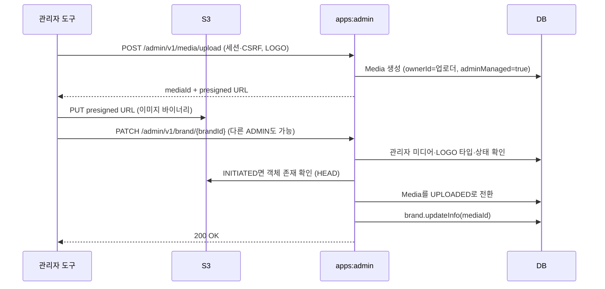

# 어드민 브랜드 관리

공통 구성과 계층 규칙은 [어드민 앱 요청 flow](admin-flow.md)를 따릅니다.

## 구현 구조

`map/api`의 Controller·Dto·Mapper가 요청을 변환하고 `BrandAdminFacade`가 트랜잭션 경계를 잡아 `:domain`의 `BrandService`에 위임합니다. `DomainServiceConfig`는 `BrandService`만 명시적으로 등록합니다. `map/infra/persist`는 admin용 `BrandRepository` 구현과 JPA·QueryDSL 조회를 소유합니다.

| Method | Path | 동작 |
| --- | --- | --- |
| GET | `/admin/v1/brand` | 목록 조회 (supportsQr, exposeToMap 필터) |
| GET | `/admin/v1/brand/search` | keyword 검색 |
| POST | `/admin/v1/brand` | 등록 |
| PATCH | `/admin/v1/brand/{brandId}` | 부분 수정 |
| DELETE | `/admin/v1/brand/{brandId}` | soft delete |

목록 조회는 `CountedPage`를 사용하며 전체 건수와 전체 페이지 수를 반환합니다. 삭제 필터는 `Brand`의 `@SQLRestriction`에 맡깁니다. 소프트 삭제 테스트는 JPA 조회 대신 native SQL로 행 존재와 media 연결을 확인합니다.

## 부분 수정과 이미지 변경

`PATCH /admin/v1/brand/{brandId}`는 null 필드를 "변경하지 않음"으로 해석합니다.

- 넘긴 필드만 변경: name, code, mediaId, supportAndroidQr, supportIosQr, exposeToMap
- 전부 null이면 `BrandCommand.UpdateBrand.hasNoChanges`가 `INVALID_PARAMETER`로 판정
- 엔티티 변경은 `Brand.updateInfo`가 담당하며 null 인자를 무시

이미지 바이너리는 admin 서버를 거치지 않습니다. 관리자 세션으로 admin의 업로드 티켓을 발급받아 S3에 직접 올린 뒤, 권한이 있는 관리자가 mediaId를 브랜드에 연결합니다.

이미지 변경은 dirty checking으로 반영됩니다. mediaId가 없거나 관리자 업로드 미디어가 아니거나 LOGO 타입이 아니거나 S3 업로드가 끝나지 않았으면 브랜드 변경 전체를 롤백합니다. 등록·수정·삭제 권한은 현재 세션의 ADMIN 여부로 검사하며, 업로더의 `ownerId`와 일치할 필요는 없습니다. 이전 mediaId의 TB_MEDIA 레코드와 S3 객체는 정리하지 않습니다.
