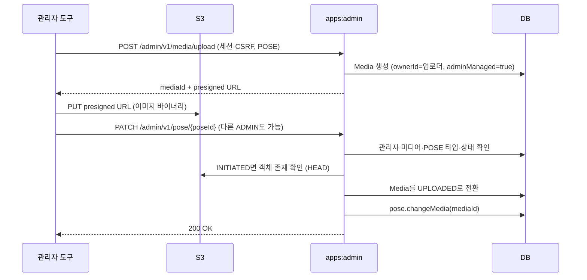

# 어드민 포즈 관리

공통 구성과 계층 규칙은 [어드민 앱 요청 flow](admin-flow.md)를 따릅니다.

## 구현 구조

`pose/api`의 Controller·Dto·Mapper가 요청을 변환하고 `PoseAdminFacade`가 트랜잭션 경계를 잡아 `:domain`의 `PoseService`에 위임합니다. `PoseServiceConfig`는 `PoseService`만 명시적으로 등록하므로 브랜드 관리 기능 없이 기동할 수 있습니다. `pose/infra/persist`는 admin용 `PoseRepository` 구현과 JPA·QueryDSL 조회를 소유합니다.

| Method | Path | 동작 |
| --- | --- | --- |
| GET | `/admin/v1/pose` | 목록 조회 (headCount 필터) |
| POST | `/admin/v1/pose` | 일괄 등록 |
| PATCH | `/admin/v1/pose/{poseId}` | 이미지 교체 |

목록 조회는 `CountedPage`를 사용하며 전체 건수와 전체 페이지 수를 반환합니다. 사용자 컨텍스트(스크랩, 정렬)가 필요한 API 전용 조회는 admin 어댑터에서 지원하지 않습니다.

관리자 공동 관리 포즈의 userId는 null로 저장합니다. 업로더는 `TB_MEDIA.owner_id`에 남습니다. `TB_POSE.user_id` NULL 허용 마이그레이션은 main의 `V30__alter_pose_user_id_nullable.sql`에 있으므로 중복 마이그레이션을 추가하지 않습니다.

## 이미지 변경

`PATCH /admin/v1/pose/{poseId}`의 body는 `{ "mediaId": n }`이며 mediaId는 필수입니다. `PoseService.updatePoseMedia`가 포즈를 조회하고 `Pose.changeMedia`로 교체합니다. dirty checking과 `@DynamicUpdate`로 media_id 변경을 저장합니다.

이미지 바이너리는 admin 서버를 거치지 않습니다. 관리자 세션으로 admin의 업로드 티켓을 발급받아 S3에 직접 올린 뒤, 권한이 있는 관리자가 mediaId를 포즈에 연결합니다.

admin은 mediaId가 없거나 관리자 업로드 미디어가 아니거나 POSE 타입이 아니거나 S3 업로드가 끝나지 않았으면 포즈 변경 전체를 롤백합니다. 등록·수정 권한은 현재 세션의 ADMIN 여부로 검사하며, 업로더의 `ownerId`와 일치할 필요는 없습니다. 이전 mediaId의 TB_MEDIA 레코드와 S3 객체는 정리하지 않습니다.
